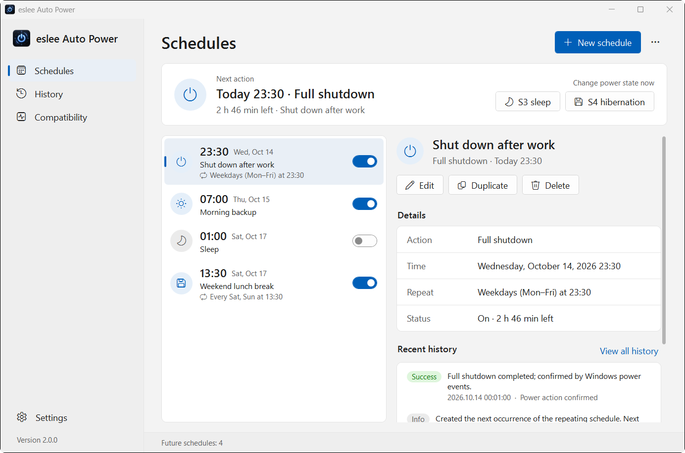
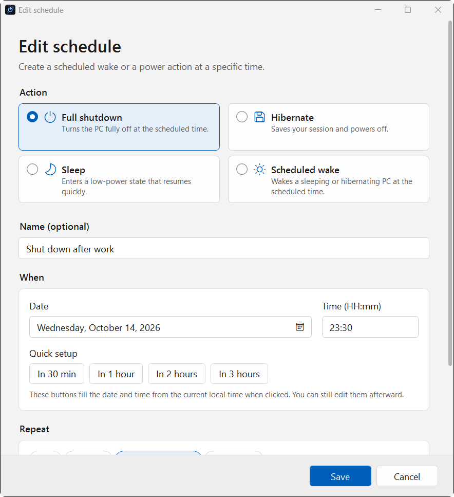
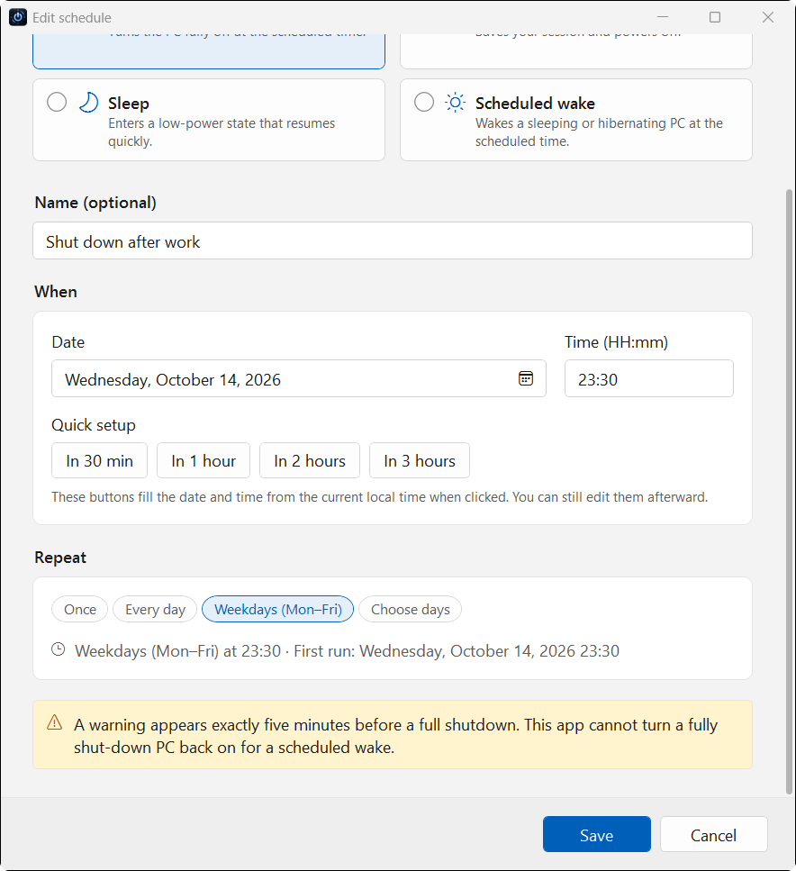
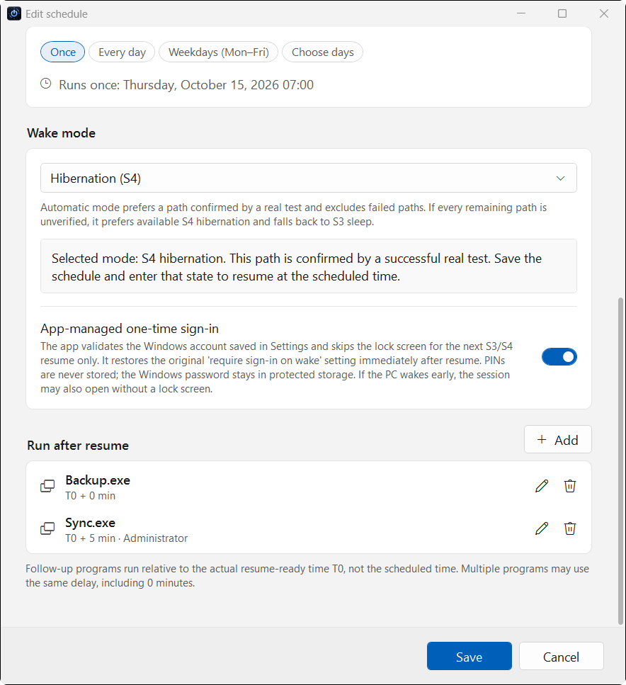
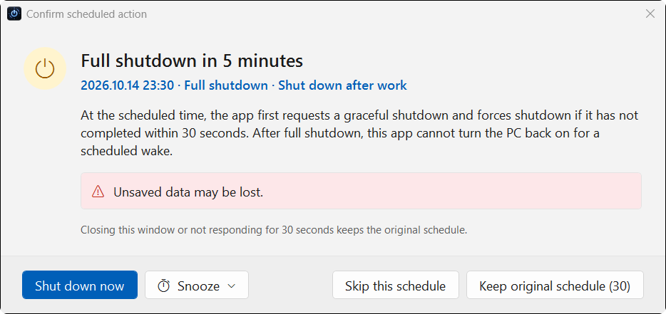
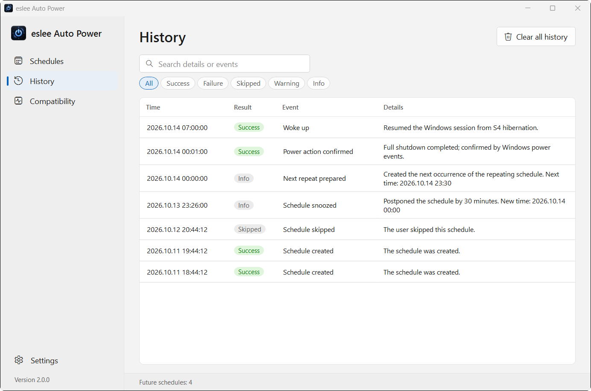
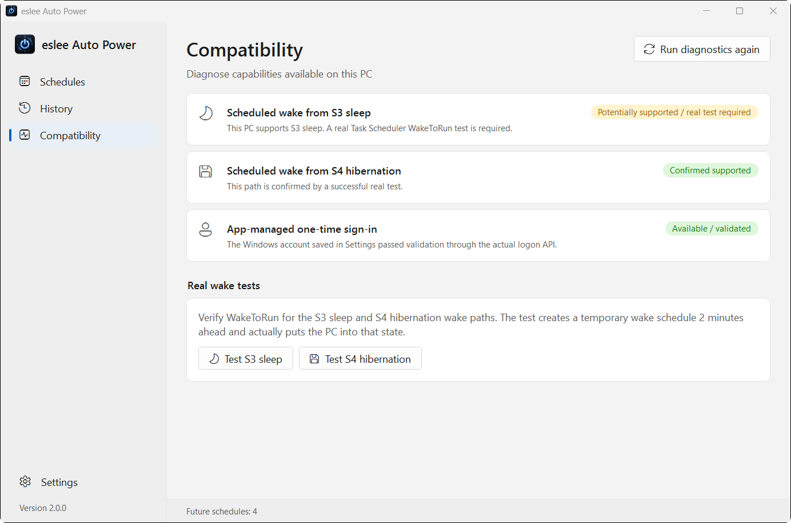
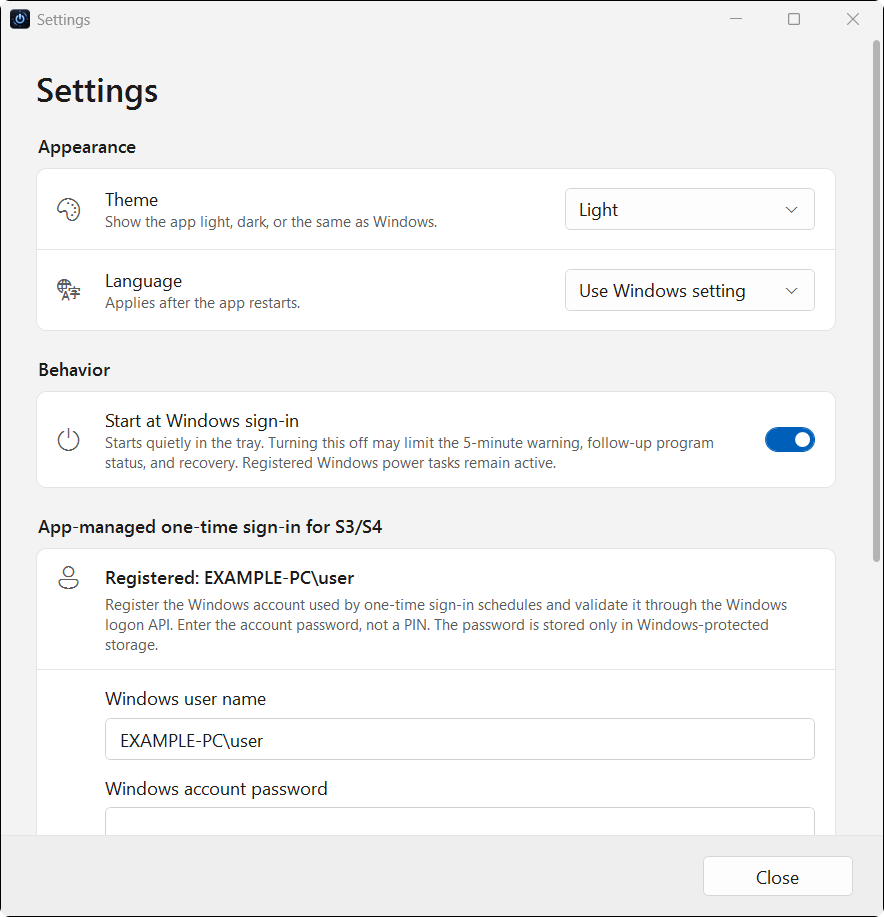
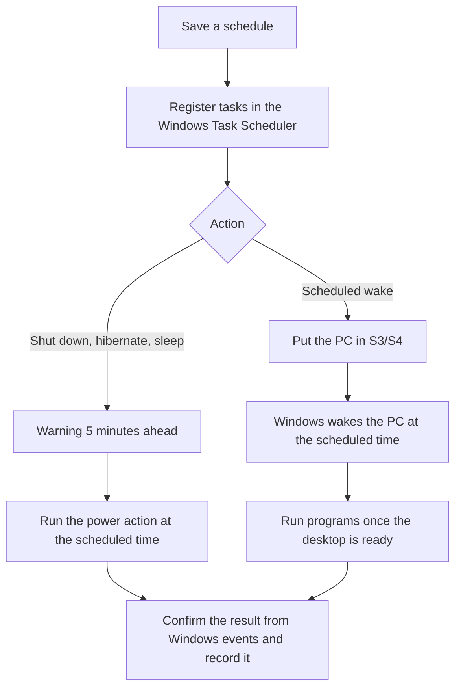

# eslee Auto Power

Current release: **v2.0.0** — [changes, validation and limits](.github/release-notes/v2.0.0.md).

A Windows 11 app that shuts down, hibernates or sleeps your PC at a set time, and wakes a sleeping or hibernating PC at a scheduled time to run the programs you choose.

[⬇️ **Download the latest version**](https://github.com/esleeeeee/eslee-auto-power/releases/latest)

**Documentation:** [한국어](README.md) · English



## Introduction

If you often forget to turn your PC off after work, or wish it were already on with your programs running when you arrive in the morning, this app can help.

- **Power schedules:** shut down, hibernate or sleep the PC at a set time, once or repeating every day, on weekdays, or on chosen days.
- **Scheduled wake:** wake a PC from sleep (S3) or hibernation (S4) at a scheduled time and run the programs you chose once the desktop is ready.

> **Note:** the app cannot turn on a PC that was fully shut down (S5). To use scheduled wake, leave the PC in sleep or hibernation.

## Main features

- Shutdown, hibernate and sleep schedules, repeating every day, on weekdays or on chosen days
- Scheduled wake from sleep or hibernation, and programs that run after resume
- A warning 5 minutes before a power action, with **Snooze** (10, 30 or 60 minutes)
- The next action with the time remaining, schedule names, duplicating schedules
- Tray menu shortcuts: shut down, hibernate or sleep in 30 minutes to 3 hours with two clicks
- History search and filters, and a notice about missed or failed runs
- Light/dark themes, Korean/English

## 1. Install

1. On the [latest release page](https://github.com/esleeeeee/eslee-auto-power/releases/latest), download the file whose name ends in `setup.exe` (`eslee-auto-power-v<version>-setup.exe`).
   - `Source code (zip)` and `Source code (tar.gz)` are source archives; you do not need them.
   - One installer supports both English and Korean.
2. Run the downloaded file.
3. If **Windows protected your PC** appears, select **More info** → **Run anyway**.
   The warning appears because the installer is not code-signed. Make sure the file came from the official page above.
4. Select **Yes** in the **Do you want to allow this app to make changes to your device?** (UAC) prompt and finish the setup.

> Requirements: Windows 11 (64-bit). If an earlier version (v1.x) is installed, install over it. Your schedules and history are kept.

## 2. First run

On first run a short welcome window appears. **Check compatibility** opens the page that shows which wake methods this PC supports.

- The app turns on **Start at Windows sign-in** on first run, so the 5-minute warning and the programs after resume work reliably. You can turn it off in **Settings**.
- Selecting **X** does not exit the app; it hides in the tray (the icon area at the right of the taskbar). Schedules are registered in the Windows Task Scheduler, so they still run while the window is closed.

## 3. Create a power schedule (shut down, hibernate, sleep)



1. On the **Schedules** page, select **New schedule** (`Ctrl+N`).
2. Under **Action**, choose **Full shutdown**, **Hibernate** or **Sleep**.
3. Optionally enter a **Name** (for example, `Shut down after work`). The name appears in the list and in the warning window.
4. Under **When**, set the date and time (`HH:mm`, for example `23:30`). **In 30 min / In 1 hour / In 2 hours / In 3 hours** fill them in from the current time.
5. Choose **Repeat**.



| Repeat | Behavior |
|---|---|
| **Once** | Runs once at the chosen date and time |
| **Every day** | Runs at the same time every day |
| **Weekdays (Mon–Fri)** | Runs Monday through Friday |
| **Choose days** | Runs only on the selected days (for example, Sat and Sun) |

When you choose a repeat, the **first run** time is shown below. For example, choosing **Weekdays** on a Saturday makes the first run the next Monday.

6. Select **Save**, then **Yes** in the UAC prompt. Registering tasks in the Windows Task Scheduler needs administrator approval.

> When you schedule a full shutdown and a scheduled wake comes after it, the app reminds you that a PC that is fully off cannot be woken.

## 4. Wake the PC at a set time (scheduled wake)

Scheduled wake **does not work just by saving the schedule.** Before the scheduled time, the PC must be in the same sleep or hibernation state as the schedule.

1. In **New schedule**, choose **Scheduled wake** and set the date, time and repeat.
2. Choose the **Wake mode**:
   - **Automatic (recommended)**: prefers a method that passed a real test.
   - **Sleep (S3)** or **Hibernation (S4)**: choose one yourself.
3. Select **Save**. If the app asks whether to enter that state now, select **Yes** to switch right away.
4. To switch later, select **S3 sleep** or **S4 hibernation** at the top of the main window. Choose the same method as the schedule.
5. At the scheduled time, Windows wakes the PC.



### Programs to run after resume

Under **Run after resume**, select **Add** and choose an executable (`.exe`), or drop one onto the window.

- The delay counts from **when the desktop is actually ready (T0)**, not from the scheduled time. `0` runs it as soon as the desktop is ready.
- Several programs can share the same delay, and one failure does not stop the others.
- **Advanced options** set arguments, the working folder and **Run as administrator**. Use administrator mode only for programs you trust.

### App-managed one-time sign-in (optional)

Use it when you want to skip the Windows lock screen **once** after resume.

1. In **Settings > App-managed one-time sign-in for S3/S4**, enter your Windows user name and **Windows account password**, then select **Save and validate**. Windows Hello PINs are not supported.
2. Turn on **App-managed one-time sign-in** in the wake schedule.

> With this on, the lock screen may be skipped even if you wake the PC yourself before the scheduled time. Use it only on a PC that others cannot reach.

## Main window

The main window has **navigation** on the left (Schedules, History, Compatibility) and **content** on the right (top image).

| Item | Description |
|---|---|
| **Next action** | The nearest schedule and the time remaining |
| **S3 sleep / S4 hibernation** | Puts the PC in that state now. A matching wake schedule is prepared first |
| **New schedule** | Creates a schedule (`Ctrl+N`) |
| **⋯** (next to New schedule) | **Pause all**, **Turn all back on**, **Refresh** |
| Schedule list | Time, date, name and repeat. The switch on the right turns a schedule on or off |
| Right-click a schedule | **Edit**, **Duplicate**, **Turn on/off**, **View history**, **Delete** |
| Details on the right | Action, time, repeat, status and recent history of the selected schedule |

Double-click a schedule or press `Enter` to edit it; press `Delete` to delete it.

## 5. The 5-minute warning and snooze



Shutdown, hibernate and sleep schedules show a warning 5 minutes ahead.

| Button | Behavior |
|---|---|
| **Shut down now** (or hibernate/sleep) | Runs it right away |
| **Snooze** | Postpones by **10 minutes / 30 minutes / 1 hour**. A repeating schedule keeps its usual time for later occurrences |
| **Skip this schedule** | Skips this occurrence only. A repeating schedule moves on to the next one |
| **Keep original schedule** | Runs at the scheduled time |

If you close the window or choose nothing for 30 seconds, the original schedule is kept. Snooze and skip may show a UAC prompt.

## 6. History



**History** lists schedule creation, snoozes, results, wake-ups and more.

- Type in the search box to find details or events.
- Filter by **All / Success / Failure / Skipped / Warning / Info**.
- Right-click a schedule and choose **View history** to see only that schedule (all occurrences of a repeating one).
- When a run is missed or fails, a yellow notice appears at the top of the main window. **View history** or **X** hides it until a new problem happens.

## 7. Compatibility



**Compatibility** shows whether this PC supports scheduled wake from sleep (S3) and hibernation (S4).

- **Potentially supported / real test required**: the PC supports the state, but it has not been woken for real yet.
- **Test S3 sleep / Test S4 hibernation** creates a temporary schedule 2 minutes ahead and actually puts the PC into that state. Save your work first. If the PC wakes by itself, the status changes to **Confirmed supported**.
- If hibernation is off, run `powercfg /hibernate on` in an elevated terminal and select **Run diagnostics again**. The app never changes this setting itself.

## Settings



Open **Settings** at the bottom left. Changes apply immediately; there is no save button.

| Item | Description |
|---|---|
| **Appearance > Theme** | Use Windows setting / Light / Dark |
| **Appearance > Language** | Use Windows setting / 한국어 / English (applies after restart) |
| **Behavior > Start at Windows sign-in** | Starts quietly in the tray at sign-in |
| **App-managed one-time sign-in for S3/S4** | Saves, validates or removes the account used for one-time sign-in |
| **Diagnostics and about** | Opens the diagnostic log folder; version and update check |

## System tray

Double-click the tray icon to open the window; right-click it for these items:

- **Shut down in 1 hour / Shut down in 2 hours**: creates the schedule without a confirmation and shows the scheduled time in a notification.
- **More quick schedules**: shut down, hibernate or sleep in 30 minutes, 1, 2 or 3 hours
- **Next schedule**, **Open app**, **New schedule**, **Pause all schedules**, **Turn all paused schedules back on**, **Exit app**

Hovering over the tray icon shows the next action and the time remaining. With eslee Tray Folder, the same items appear inside the Tray Folder menu instead of a separate tray icon.

## Which power state should I choose?

| Situation | Recommended | Notes |
|---|---|---|
| Stepping away briefly and coming back soon | Sleep (S3) | Resumes quickly but still uses a little power |
| Not using the PC for hours but needing scheduled wake later | Hibernation (S4) | Uses almost no power and keeps your session. Windows hibernation must be on |
| Turning the PC off with no need to wake it | Full shutdown (S5) | This app cannot turn it back on |

## Troubleshooting

**The PC did not wake at the scheduled time.**
Check that the schedule's wake mode matches the state you put the PC in (S3/S4). Run the real test again on **Compatibility**. Laptops may disable wake timers on battery, and firmware (BIOS/UEFI) sleep and wake settings also matter.

**I selected "No" in the UAC prompt.**
Nothing changed. Repeat the action and select **Yes**.

**The app disappeared when I selected X.**
It is hidden in the tray. Double-click the tray icon. To exit completely, choose **Exit app** in the tray menu.

**Hibernation is missing or cannot be tested.**
Windows hibernation may be off. Run `powercfg /hibernate on` in an elevated terminal, then **Compatibility > Run diagnostics again**.

**Windows asks for my password after waking.**
That is the normal lock screen. Use **App-managed one-time sign-in** only when you need to skip it once.

**A yellow notice appears on the main window.**
A run was missed or failed. Check **View history**. The most common cause is the PC being off at the scheduled time.

**I want to change the app language.**
Choose it in **Settings > Appearance > Language** and restart the app. A PC that used the former English edition also follows the Windows display language, so choose English here if needed.

**SmartScreen shows a warning.**
The installer is not code-signed. Confirm the file came from the official [Releases page](https://github.com/esleeeeee/eslee-auto-power/releases/latest), then select **More info → Run anyway**.

If the problem remains, open the diagnostic logs (`%ProgramData%\eslee\AutoPower\logs`) with **Settings > Diagnostics and about > Open folder**, and report the symptom and steps on [GitHub Issues](https://github.com/esleeeeee/eslee-auto-power/issues). Remove user names and paths before attaching logs.

## Update and uninstall

- **Update**: run the new installer. Schedules, history and settings are kept. The About window (**Settings > About and updates**) checks for a new version.
- **Uninstall**: remove the app from the Windows app list. Uninstalling removes the app's Task Scheduler tasks, the saved sign-in credentials and the startup entry, **and also deletes the schedule and history data (`%ProgramData%\eslee\AutoPower`)**.

## Privacy

- No account, ads or usage statistics.
- The internet is used only to check for a new version. The app reads public GitHub Release information, sends nothing about your PC, and never updates itself.
- Schedules, history, compatibility results and diagnostic logs are stored in `%ProgramData%\eslee\AutoPower`.
- The Windows password saved for one-time sign-in stays in Windows-protected storage and is never written to the database or logs.

See [Privacy](PRIVACY.md) and [Security](SECURITY.md) for details.

## Limitations

- Windows 11 (64-bit) only.
- A fully shut down PC (S5) cannot be turned on; scheduled wake works only from sleep (S3) and hibernation (S4).
- Wake results depend on firmware, Windows wake timer settings and manufacturer power policies.
- The next occurrence of a repeating schedule is created when an occurrence runs, is skipped or is missed. If the PC was off, it is created at the next sign-in.
- Saving, changing and deleting schedules require UAC approval.
- See [Limitations](docs/limitations.md) for more.

## How it works



1. Saving a schedule makes the elevated helper register app-only tasks in the Windows Task Scheduler (`\eslee\AutoPower\`).
2. Before calling the Windows power API, the app records the pending action in its database. After the PC comes back, it checks Windows event logs to settle the result as completed, failed or missed.
3. Scheduled wake uses Windows wake timers (WakeToRun); an agent in your session waits until the desktop is ready and then runs your programs.

See the [architecture document](docs/architecture.md) (Korean) for internals.

## Developer documentation

Building requires Windows 11 and the .NET SDK 10.0.301.

```powershell
git clone https://github.com/esleeeeee/eslee-auto-power.git
Set-Location eslee-auto-power
dotnet build .\AutoPower.sln -c Release
dotnet test .\tests\AutoPower.Tests\AutoPower.Tests.csproj -c Release --no-build
```

Korean and English are chosen at runtime from the same build. `.\scripts\Build-Release.ps1 -Version 2.0.0` creates the single installer (Inno Setup 6 required).

```text
src/AutoPower.App       WPF UI, tray, 5-minute warning
src/AutoPower.Core      Schedule model, repeat rules, validation, display text
src/AutoPower.Data      SQLite storage
src/AutoPower.Windows   Task Scheduler, power, credentials, recovery
src/AutoPower.Helper    Elevated command runner
src/AutoPower.Agent     Resume check and follow-up programs
tests/AutoPower.Tests   Automated tests
installer               Inno Setup definition
```

- [Architecture](docs/architecture.md) — processes, schedule save order, power transition recovery
- [Limitations](docs/limitations.md) — known limits
- [Verification](docs/verification.md) — verification notes from earlier versions
- [CHANGELOG](CHANGELOG.md) — release history

This project was built end to end through vibe coding with AI coding agents. Screenshots use example data.

## License

Released under the [MIT License](LICENSE). Anyone may use, modify and distribute it, provided the copyright notice and license text are included. The software is provided as is, without warranty of any kind.
