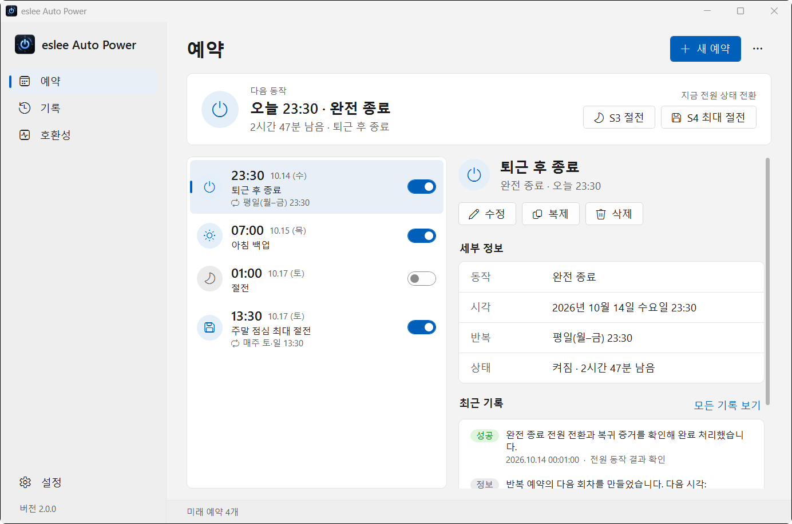
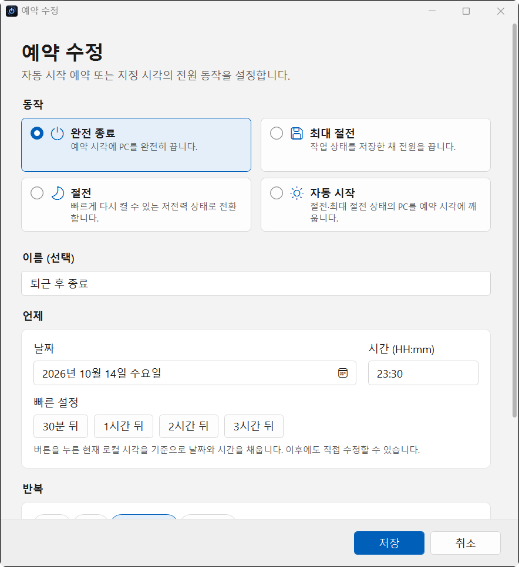
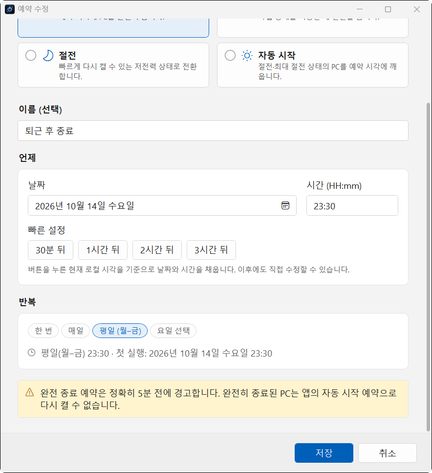
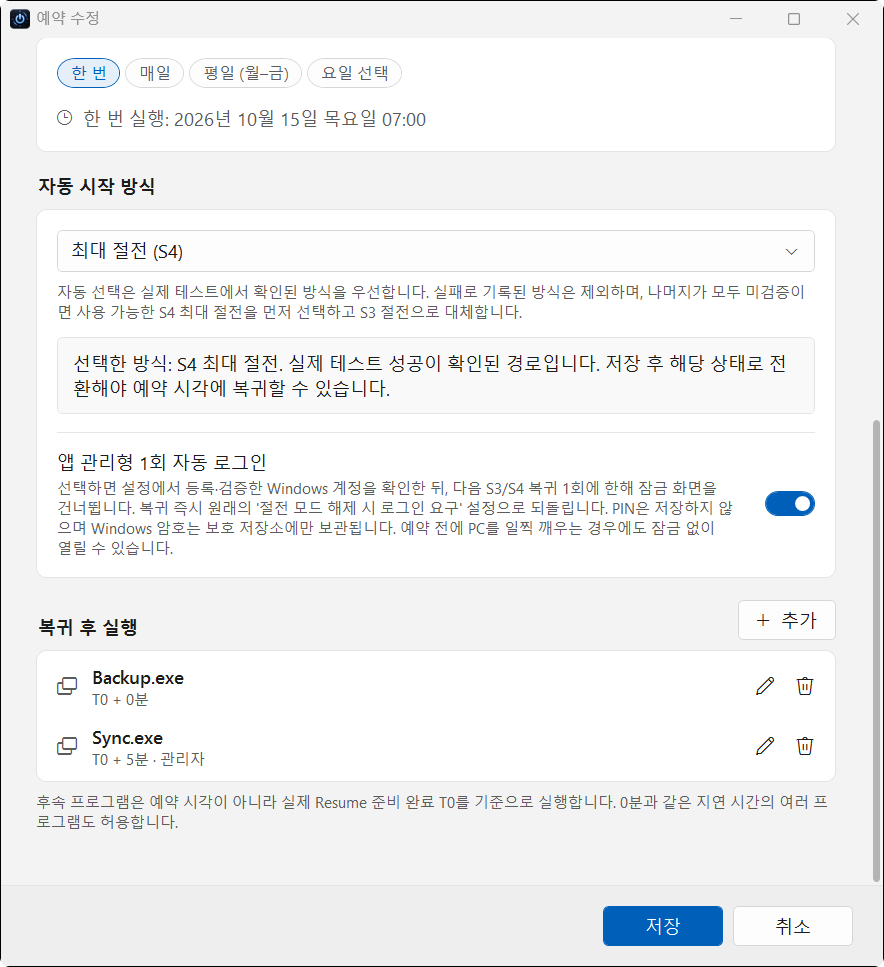
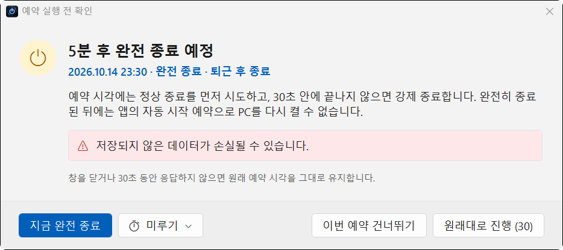
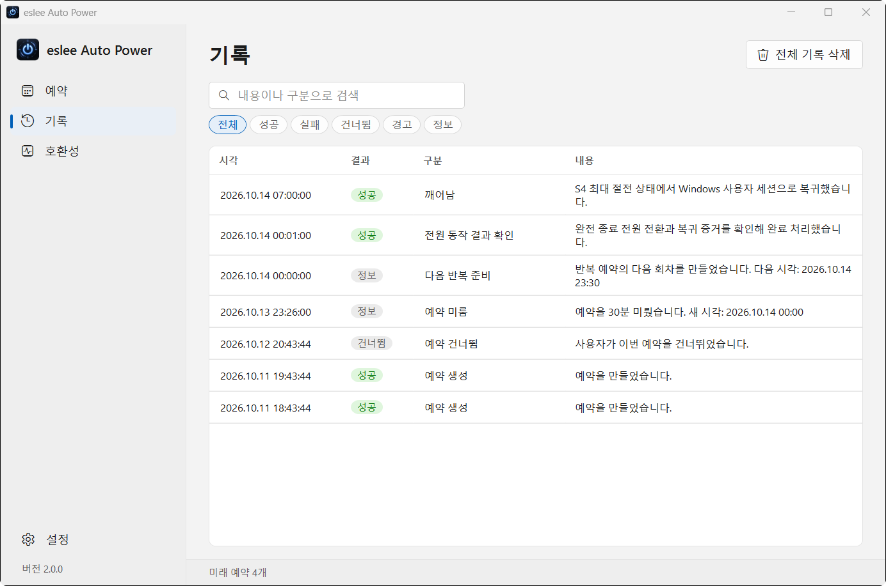
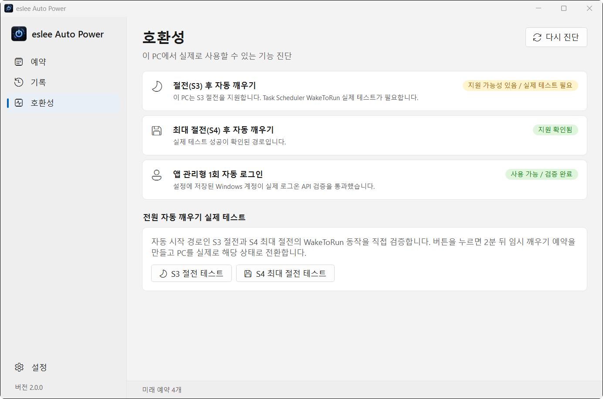
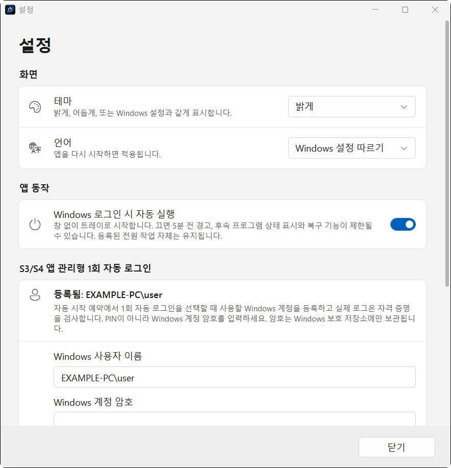
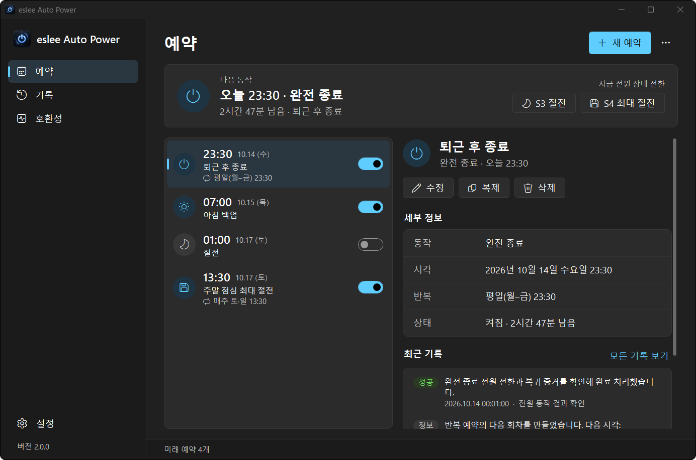
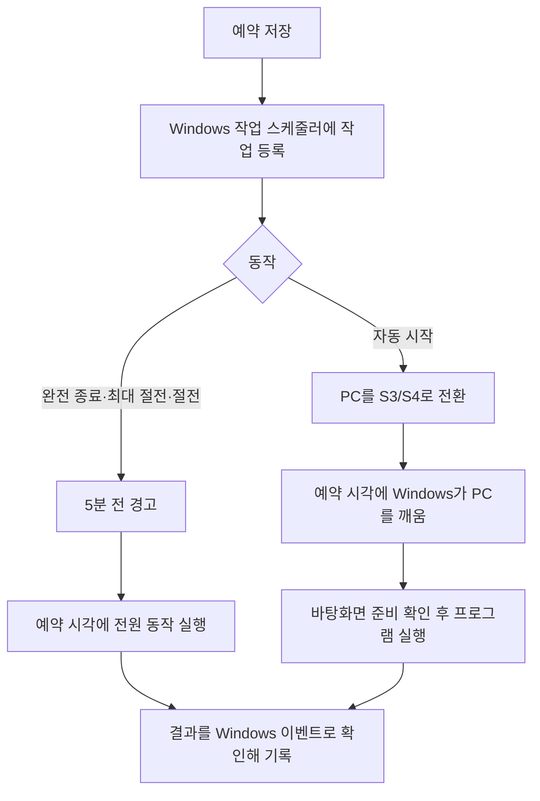

# eslee Auto Power

현재 릴리스 버전: **v2.0.0** — [변경·검증·제한](.github/release-notes/v2.0.0.md).

정해진 시각에 PC를 완전 종료하거나 최대 절전·절전 상태로 바꾸고, 절전·최대 절전 상태의 PC를 예약 시각에 깨워 원하는 프로그램을 실행하는 Windows 11 프로그램입니다.

[⬇️ **최신 버전 다운로드**](https://github.com/esleeeeee/eslee-auto-power/releases/latest)

**문서 언어:** 한국어 · [English](README.en.md)



## 소개

퇴근할 때 PC를 끄는 것을 자주 잊거나, 아침에 출근하기 전에 PC가 미리 켜져서 필요한 프로그램이 실행되어 있으면 좋겠다고 생각한 적이 있다면 이 프로그램이 도움이 됩니다.

- **전원 예약:** 정해진 시각에 PC를 완전 종료, 최대 절전, 절전 상태로 바꿉니다. 매일, 평일, 원하는 요일에 반복할 수 있습니다.
- **자동 시작 예약:** 절전(S3)이나 최대 절전(S4) 상태의 PC를 예약 시각에 깨우고, 바탕화면이 준비되면 지정한 프로그램을 실행합니다.

> **참고:** 완전히 종료한 PC(S5)는 이 프로그램이 다시 켤 수 없습니다. 자동 시작을 쓰려면 PC를 절전이나 최대 절전 상태로 두어야 합니다.

## 주요 기능

- 완전 종료·최대 절전·절전 예약, 매일·평일·요일 반복
- 절전·최대 절전에서 예약 시각에 자동으로 깨우기, 깨어난 뒤 프로그램 실행
- 실행 5분 전 경고와 **미루기**(10분·30분·1시간)
- 다음 동작과 남은 시간 표시, 예약 이름 붙이기, 예약 복제
- 트레이 메뉴에서 30분~3시간 뒤 종료·최대 절전·절전을 두 번의 클릭으로 예약
- 실행 기록 검색과 필터, 놓치거나 실패한 실행 알림
- 라이트/다크 테마, 한국어/English

## 1. 설치

1. [최신 버전 페이지](https://github.com/esleeeeee/eslee-auto-power/releases/latest)에서 이름이 `setup.exe`로 끝나는 파일(`eslee-auto-power-v버전-setup.exe`)을 내려받습니다.
   - `Source code (zip)`, `Source code (tar.gz)`는 소스 코드 묶음이므로 받지 않아도 됩니다.
   - 설치 파일 하나가 한국어와 영어를 모두 지원합니다.
2. 내려받은 파일을 실행합니다.
3. **Windows의 PC 보호** 창이 나타나면 **추가 정보** → **실행**을 누릅니다.
   설치 파일에 코드 서명이 없어서 표시되는 경고입니다. 위의 공식 페이지에서 받은 파일인지 먼저 확인하세요.
4. **이 앱이 디바이스를 변경하도록 허용하시겠어요?**(UAC, 관리자 권한 확인) 창에서 **예**를 누르고 설치를 마칩니다.

> 지원 환경: Windows 11(64비트). 이전 버전(v1.x)이 설치되어 있으면 그 위에 설치하면 됩니다. 예약과 기록은 그대로 유지됩니다.

## 2. 처음 실행

처음 실행하면 간단한 안내 창이 나타납니다. **호환성 확인**을 누르면 이 PC가 어떤 자동 시작 방식을 지원하는지 보여 주는 화면으로 이동합니다.

- 앱은 처음 실행할 때 **Windows 로그인 시 자동 실행**을 켭니다. 그래야 5분 전 경고와 복귀 후 프로그램 실행이 제대로 동작합니다. 원하지 않으면 **설정**에서 끌 수 있습니다.
- 창의 **X**를 누르면 프로그램이 종료되지 않고 트레이(작업 표시줄 오른쪽 아이콘 영역)로 숨겨집니다. 예약은 앱 창을 닫아도 Windows 작업 스케줄러에 등록되어 있어 그대로 실행됩니다.

## 3. 전원 예약 만들기 (종료·최대 절전·절전)



1. **예약** 화면에서 **새 예약**을 누릅니다(`Ctrl+N`).
2. **동작**에서 **완전 종료**, **최대 절전**, **절전** 중 하나를 고릅니다.
3. 필요하면 **이름**을 입력합니다(예: `퇴근 후 종료`). 목록과 경고 창에 이 이름이 표시됩니다.
4. **언제**에서 날짜와 시간(`HH:mm`, 예: `23:30`)을 정합니다. **30분 뒤 / 1시간 뒤 / 2시간 뒤 / 3시간 뒤**를 누르면 지금 시각을 기준으로 바로 채워집니다.
5. **반복**을 고릅니다.



| 반복 | 동작 |
|---|---|
| **한 번** | 정한 날짜와 시간에 한 번만 실행합니다 |
| **매일** | 매일 같은 시간에 실행합니다 |
| **평일 (월–금)** | 월요일부터 금요일까지 실행합니다 |
| **요일 선택** | 고른 요일에만 실행합니다(예: 토·일) |

반복을 고르면 아래에 **첫 실행 시각**이 표시됩니다. 예를 들어 토요일에 **평일**을 고르면 첫 실행은 다음 월요일이 됩니다.

6. **저장**을 누르고 UAC 창에서 **예**를 누르면 예약이 등록됩니다. Windows 작업 스케줄러에 작업을 등록하려면 관리자 승인이 필요합니다.

> 완전 종료를 예약할 때 그 뒤에 자동 시작 예약이 있으면, 완전히 꺼진 PC는 자동 시작으로 켜지지 않는다는 안내가 나타납니다.

## 4. 정해진 시간에 PC 깨우기 (자동 시작)

자동 시작은 **예약을 저장하는 것만으로는 동작하지 않습니다.** 예약 시각 전에 PC를 예약과 같은 방식의 절전 또는 최대 절전 상태로 두어야 합니다.

1. **새 예약**에서 동작으로 **자동 시작**을 고르고 날짜·시간·반복을 정합니다.
2. **자동 시작 방식**을 고릅니다.
   - **자동 선택 (추천)**: 실제 테스트에서 성공한 방식을 먼저 고릅니다.
   - **절전 (S3)** 또는 **최대 절전 (S4)**: 직접 고릅니다.
3. **저장**을 누릅니다. 저장 직후 "지금 이 상태로 전환할까요?"라는 안내가 나타나면 **예**를 눌러 바로 전환해도 됩니다.
4. 나중에 전환하려면 메인 화면 위쪽의 **S3 절전** 또는 **S4 최대 절전** 버튼을 누릅니다. 예약과 같은 방식을 눌러야 합니다.
5. 예약 시각이 되면 Windows가 PC를 깨웁니다.



### 복귀 후 실행할 프로그램

**복귀 후 실행**에서 **추가**를 누르고 실행 파일(`.exe`)을 고르거나 창으로 끌어다 놓습니다.

- 지연 시간은 예약 시각이 아니라 **바탕화면이 실제로 준비된 시점(T0)**부터 계산합니다. `0`이면 준비되자마자 실행합니다.
- 같은 지연 시간으로 여러 프로그램을 등록할 수 있고, 하나가 실패해도 나머지는 계속 실행됩니다.
- **고급 옵션**에서 실행 인수, 작업 폴더, **관리자 권한으로 실행**을 정할 수 있습니다. 관리자 권한 실행은 신뢰할 수 있는 프로그램에만 사용하세요.

### 앱 관리형 1회 자동 로그인 (선택)

깨어난 뒤 Windows 잠금 화면을 **한 번만** 건너뛰고 싶을 때 사용합니다.

1. **설정 > S3/S4 앱 관리형 1회 자동 로그인**에서 Windows 사용자 이름과 **Windows 계정 암호**를 입력하고 **저장 및 검증**을 누릅니다. Windows Hello PIN은 사용할 수 없습니다.
2. 자동 시작 예약에서 **앱 관리형 1회 자동 로그인**을 켭니다.

> 이 기능을 켜면 예약 전에 PC를 직접 깨운 경우에도 잠금 화면이 생략될 수 있습니다. 다른 사람이 만질 수 없는 PC에서만 사용하세요.

## 화면 구성

메인 창은 왼쪽 **탐색**(예약·기록·호환성)과 오른쪽 **내용**으로 나뉩니다(맨 위 사진).

| 항목 | 설명 |
|---|---|
| **다음 동작** | 가장 가까운 예약과 남은 시간을 보여 줍니다 |
| **S3 절전 / S4 최대 절전** | 지금 PC를 해당 상태로 바꿉니다. 같은 방식의 자동 시작 예약이 있으면 그 예약을 먼저 준비합니다 |
| **새 예약** | 예약을 만듭니다 (`Ctrl+N`) |
| **⋯** (새 예약 오른쪽) | **모두 일시 중지**, **모두 다시 켜기**, **새로 고침** |
| 예약 목록 | 시각, 날짜, 이름, 반복 여부를 보여 줍니다. 오른쪽 스위치로 예약을 켜거나 끕니다 |
| 예약 우클릭 | **수정**, **복제**, **켜기/끄기**, **기록 보기**, **삭제** |
| 오른쪽 세부 정보 | 선택한 예약의 동작, 시각, 반복, 상태, 최근 기록을 보여 줍니다 |

목록에서 예약을 두 번 클릭하거나 `Enter`를 누르면 수정 창이 열리고, `Delete`를 누르면 삭제합니다.

## 5. 실행 5분 전 경고와 미루기



완전 종료·최대 절전·절전 예약은 실행 5분 전에 경고 창이 나타납니다.

| 버튼 | 동작 |
|---|---|
| **지금 완전 종료**(또는 최대 절전·절전) | 기다리지 않고 바로 실행합니다 |
| **미루기** | **10분 / 30분 / 1시간** 뒤로 미룹니다. 반복 예약이라도 다음 회차의 시간은 바뀌지 않습니다 |
| **이번 예약 건너뛰기** | 이번 회차만 실행하지 않습니다. 반복 예약이면 다음 회차로 넘어갑니다 |
| **원래대로 진행** | 예약 시각에 그대로 실행합니다 |

창을 닫거나 30초 동안 아무것도 고르지 않으면 원래 예약대로 진행합니다. 미루기와 건너뛰기는 UAC 확인이 필요할 수 있습니다.

## 6. 기록



**기록**에서 예약 생성, 미루기, 실행 결과, 깨어남 같은 내용을 볼 수 있습니다.

- 검색 상자에 내용이나 구분을 입력해 찾습니다.
- **전체 / 성공 / 실패 / 건너뜀 / 경고 / 정보**로 결과를 걸러 봅니다.
- 예약을 우클릭해 **기록 보기**를 고르면 그 예약(반복 예약은 모든 회차)의 기록만 보여 줍니다.
- 놓치거나 실패한 실행이 생기면 메인 화면 위에 노란 알림이 나타납니다. **기록 보기**를 누르거나 **X**로 닫으면 새 문제가 생길 때까지 숨겨집니다.

## 7. 호환성 확인



**호환성**에서 이 PC가 절전(S3)과 최대 절전(S4) 자동 깨우기를 지원하는지 확인합니다.

- **지원 가능성 있음 / 실제 테스트 필요**: PC가 그 상태를 지원하지만 아직 실제로 깨워 보지 않았습니다.
- **S3 절전 테스트 / S4 최대 절전 테스트**를 누르면 2분 뒤로 임시 예약을 만들고 PC를 실제로 그 상태로 바꿉니다. 저장하지 않은 작업을 먼저 저장하세요. 자동으로 깨어나면 **지원 확인됨**으로 바뀝니다.
- 최대 절전이 꺼져 있으면 관리자 터미널에서 `powercfg /hibernate on`을 실행한 뒤 **다시 진단**을 누릅니다. 앱은 이 설정을 직접 바꾸지 않습니다.

## 설정



왼쪽 아래 **설정**을 눌러 엽니다. 변경 사항은 저장 버튼 없이 바로 적용됩니다.

| 항목 | 설명 |
|---|---|
| **화면 > 테마** | Windows 설정 따르기 / 밝게 / 어둡게 |
| **화면 > 언어** | Windows 설정 따르기 / 한국어 / English (앱을 다시 시작하면 적용) |
| **앱 동작 > Windows 로그인 시 자동 실행** | 로그인할 때 트레이에서 조용히 시작합니다 |
| **S3/S4 앱 관리형 1회 자동 로그인** | 1회 자동 로그인에 쓸 Windows 계정을 저장·검증·제거합니다 |
| **진단 및 정보** | 진단 로그 폴더 열기, 버전 정보와 업데이트 확인 |



다크 테마를 적용한 화면입니다.

## 시스템 트레이

트레이 아이콘을 **더블 클릭**하면 창이 열리고, **우클릭**하면 아래 메뉴를 쓸 수 있습니다.

- **1시간 후 완전 종료 / 2시간 후 완전 종료**: 확인 창 없이 바로 예약을 만들고, 예약된 시각을 알림으로 보여 줍니다.
- **빠른 예약 더 보기**: 30분·1시간·2시간·3시간 뒤의 완전 종료, 최대 절전, 절전
- **다음 예약**, **앱 열기**, **새 예약**, **모든 예약 일시 중지**, **꺼 둔 예약 모두 다시 켜기**, **앱 종료**

트레이 아이콘에 마우스를 올리면 다음 동작과 남은 시간이 표시됩니다. eslee Tray Folder를 사용 중이면 별도의 트레이 아이콘 대신 Tray Folder 메뉴 안에 같은 항목이 표시됩니다.

## 어떤 전원 상태를 골라야 하나요?

| 상황 | 추천 | 알아 둘 점 |
|---|---|---|
| 잠깐 자리를 비우고 빨리 돌아올 때 | 절전 (S3) | 복귀가 빠르지만 대기 중에도 전기를 조금 씁니다 |
| 몇 시간 이상 쓰지 않지만 나중에 자동 시작이 필요할 때 | 최대 절전 (S4) | 전기를 거의 쓰지 않고 작업 상태를 그대로 보존합니다. Windows 최대 절전이 켜져 있어야 합니다 |
| 다시 켤 필요 없이 완전히 끌 때 | 완전 종료 (S5) | 이 앱으로 다시 켤 수 없습니다 |

## 문제 해결

**예약 시각에 PC가 깨어나지 않습니다.**
예약의 자동 시작 방식과 PC를 전환한 방식(S3/S4)이 같은지 확인하세요. **호환성**에서 해당 방식의 실제 테스트를 다시 해 보세요. 노트북은 전원 연결 여부에 따라 깨우기 타이머가 꺼져 있을 수 있고, PC 제조사 BIOS/UEFI의 절전·깨우기 설정에 따라서도 달라집니다.

**UAC 창에서 "아니요"를 눌렀습니다.**
예약은 바뀌지 않았습니다. 같은 작업을 다시 하고 **예**를 누르세요.

**X를 눌렀더니 프로그램이 사라졌습니다.**
트레이로 숨겨진 상태입니다. 작업 표시줄 오른쪽 아이콘을 더블 클릭하세요. 완전히 끄려면 트레이 메뉴의 **앱 종료**를 누릅니다.

**최대 절전 선택지가 없거나 테스트할 수 없습니다.**
Windows 최대 절전이 꺼져 있을 수 있습니다. 관리자 터미널에서 `powercfg /hibernate on`을 실행한 뒤 **호환성 > 다시 진단**을 누르세요.

**깨어난 뒤 Windows가 암호를 요구합니다.**
일반적인 잠금 화면 동작입니다. 잠금 화면을 한 번 건너뛰어야 할 때만 **앱 관리형 1회 자동 로그인**을 사용하세요.

**메인 화면에 노란 알림이 나타납니다.**
놓치거나 실패한 실행이 있다는 뜻입니다. **기록 보기**에서 내용을 확인하세요. PC가 꺼져 있어 예약 시각을 지나친 경우가 가장 흔합니다.

**앱 언어를 바꾸고 싶습니다.**
**설정 > 화면 > 언어**에서 고른 뒤 앱을 다시 시작합니다. 이전 영어판을 쓰던 PC도 Windows 표시 언어를 따르므로, 필요하면 여기서 English를 고르세요.

**SmartScreen 경고가 표시됩니다.**
설치 파일에 코드 서명이 없어서입니다. 공식 [Releases 페이지](https://github.com/esleeeeee/eslee-auto-power/releases/latest)에서 받은 파일인지 확인한 뒤 **추가 정보 → 실행**을 누르세요.

해결되지 않으면 **설정 > 진단 및 정보 > 폴더 열기**로 진단 로그(`%ProgramData%\eslee\AutoPower\logs`)를 확인하고, [GitHub Issues](https://github.com/esleeeeee/eslee-auto-power/issues)에 증상과 재현 순서를 남겨 주세요. 로그를 첨부할 때는 사용자 이름과 경로를 지워 주세요.

## 업데이트와 제거

- **업데이트**: 새 설치 파일을 실행하면 됩니다. 예약, 기록, 설정은 그대로 유지됩니다. 정보 창(**설정 > 정보 및 업데이트**)에서 새 버전이 있는지 확인할 수 있습니다.
- **제거**: Windows 설정의 앱 목록에서 제거합니다. 제거하면 앱이 만든 작업 스케줄러 작업, 저장한 로그인 정보, 시작 프로그램 등록과 함께 **예약·기록 데이터(`%ProgramData%\eslee\AutoPower`)도 삭제**됩니다.

## 개인정보

- 계정 가입, 광고, 사용 통계 수집이 없습니다.
- 인터넷 연결은 새 버전 확인에만 사용합니다. GitHub의 공개 Release 정보를 조회할 뿐 PC의 정보는 보내지 않으며, 자동 업데이트도 하지 않습니다.
- 예약, 실행 기록, 호환성 결과, 진단 로그는 `%ProgramData%\eslee\AutoPower`에 저장됩니다.
- 1회 자동 로그인을 위해 등록한 Windows 암호는 Windows 보호 저장소에만 보관하며, DB나 로그에 기록하지 않습니다.

자세한 내용은 [개인정보 안내](PRIVACY.md)와 [보안 정책](SECURITY.md)을 참고하세요.

## 제한 사항

- Windows 11(64비트) 전용입니다.
- 완전 종료(S5)한 PC는 다시 켤 수 없습니다. 자동 시작은 절전(S3)과 최대 절전(S4)에서만 동작합니다.
- 자동 깨우기 결과는 PC 펌웨어, Windows 깨우기 타이머 설정, 제조사 전원 정책에 따라 달라질 수 있습니다.
- 반복 예약의 다음 회차는 한 회차가 실행·건너뜀·놓침으로 끝날 때 만들어집니다. PC가 꺼져 있어 회차를 놓치면 다음 로그인 때 만들어집니다.
- 예약 저장·수정·삭제에는 UAC 승인이 필요합니다.
- 자세한 내용은 [제한 사항 문서](docs/limitations.md)를 참고하세요.

## 작동 원리



1. 예약을 저장하면 관리자 권한 도우미가 Windows 작업 스케줄러에 앱 전용 작업을 등록합니다(`\eslee\AutoPower\`).
2. 전원 동작은 실행 직전 상태를 먼저 DB에 기록한 뒤 Windows 전원 API를 호출합니다. PC가 다시 켜지면 Windows 이벤트 기록으로 실제 결과를 확인해 성공·실패·놓침을 정리합니다.
3. 자동 시작은 Windows의 깨우기 타이머(WakeToRun)로 PC를 깨우고, 사용자 세션의 도우미가 바탕화면 준비를 확인한 뒤 프로그램을 실행합니다.

자세한 내부 구조는 [아키텍처 문서](docs/architecture.md)를 참고하세요.

## 개발자용 문서

빌드하려면 Windows 11과 .NET SDK 10.0.301이 필요합니다.

```powershell
git clone https://github.com/esleeeeee/eslee-auto-power.git
Set-Location eslee-auto-power
dotnet build .\AutoPower.sln -c Release
dotnet test .\tests\AutoPower.Tests\AutoPower.Tests.csproj -c Release --no-build
```

한국어/영어 UI는 같은 빌드에서 실행 중에 고릅니다. 설치 파일 하나는 `.\scripts\Build-Release.ps1 -Version 2.0.0`으로 만듭니다(Inno Setup 6 필요).

```text
src/AutoPower.App       WPF UI, 트레이, 5분 전 경고 창
src/AutoPower.Core      예약 모델, 반복 규칙, 검증, 표시 문자열
src/AutoPower.Data      SQLite 저장소
src/AutoPower.Windows   작업 스케줄러, 전원, 자격 증명, 복구
src/AutoPower.Helper    관리자 권한 명령 실행기
src/AutoPower.Agent     복귀 확인과 후속 프로그램 실행
tests/AutoPower.Tests   자동 테스트
installer               Inno Setup 정의
```

- [아키텍처](docs/architecture.md) — 프로세스 구조, 예약 저장 순서, 전원 전환 복구
- [제한 사항](docs/limitations.md) — 알려진 한계
- [검증 결과](docs/verification.md) — 이전 버전의 검증 기록
- [CHANGELOG](CHANGELOG.md) — 버전별 변경 이력

이 프로젝트는 전 과정을 AI 코딩 에이전트와의 바이브코딩으로 개발했습니다. 화면 사진은 예시 데이터로 촬영했습니다.

## 라이선스

[MIT 라이선스](LICENSE)로 배포합니다. 누구나 자유롭게 사용·수정·배포할 수 있으며, 배포할 때는 저작권 표시와 라이선스 문구를 함께 포함해야 합니다. 프로그램은 어떠한 보증도 없이 있는 그대로 제공됩니다.
